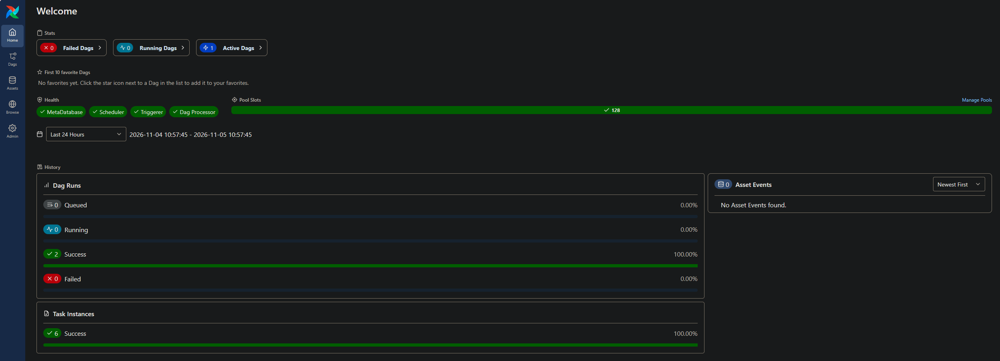
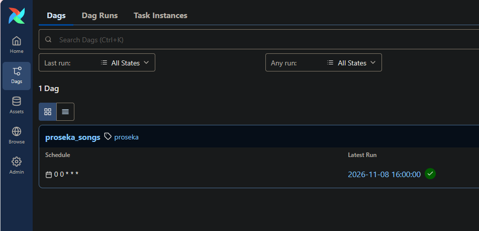
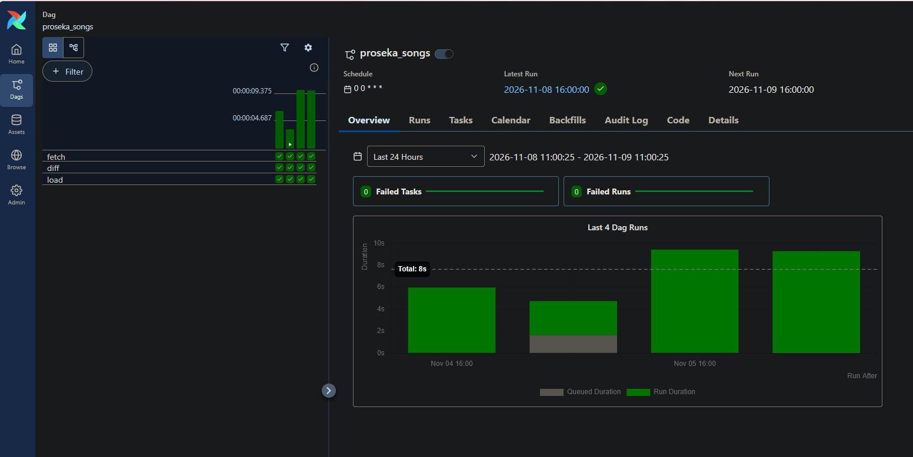

# Airflow
In October 2025, I started playing a rhythm game, Project Sekai ([Official JP Site](https://pjsekai.sega.jp/)), a Vocaloid themed rhythm game for Android and iOS devices. I hadn't really been into rhythm games previously, but I decided I was finally stable enough to like Vocaloids and Hatsune Miku without the risk of it derailing all of my plans. At the time of writing this (November 2026), I've cleared just over 3000 songs. There was no way that I was going to be a casual enjoyer of Vocaloid content. Back in March 2026, I saw that someone had been documenting when they were able to clear, full clear (FC), and all perfect (AP) songs, over the 5-ish years since the game launched, and because I'm me, I started a spreadsheet of songs I FC'd so I could look at the data later.

Up until this point, I'd been manually updating a Google Sheet that I'd made using data from the [Sekaipedia song database](https://www.sekaipedia.org/wiki/Database:Songs), making new columns, using index-matching to pull in my clear dates and notes, then going through and formatting the cells how I like them. Needless to say this was a huge pain in the ass and I pushed it off as long as possible every time, but eventually caved in the name of data integrity. Now, I could just put everything in a SQL database, but then I'd have to update a SQL database and I don't want to have to do that either. It's 2026, surely there's a way to make a pipe that goes from a list of songs and hook it up to an existing SQL database from my spreadsheet. I'm a data lady, I want to learn modern data lady tools, and what better motivation is there than removing the tedium of a task I already do by hand? 


**Enter: Airflow**

I understand that Airflow is probably overkill for what I want, but I may as well learn how to use modern data engineering tools since I do data engineering (among other things) for my job. Instead of using some random synthetic dataset and following a bootcamp template for making a DAG using Airflow, I'm using that same tool to solve a personal problem of mine that I will genuinely use daily. 

What you're about to read (or ask an LLM to read) are my real notes and documentation that I have to write or the information leaves my brain. Please excuse my bad habits and my need to explain things to myself that other people might find trivial.

## Installing Airflow
H'okay, working on Airflow today. Basically it's a scheduler to pull data into a SQL table (plus other stuff probably). First, installing:
```bash
sudo apt update && sudo apt install -y python3-venv python3-pip
mkdir -p ~/airflow-proseka && cd ~/airflow-proseka
python3 -m venv .venv && source .venv/bin/activate

AIRFLOW_VERSION=3.3.2
PYTHON_VERSION="$(python -c 'import sys; print(f"{sys.version_info.major}.{sys.version_info.minor}")')"
pip install "apache-airflow==${AIRFLOW_VERSION}" \
  --constraint "https://raw.githubusercontent.com/apache/airflow/constraints-${AIRFLOW_VERSION}/constraints-${PYTHON_VERSION}.txt"

export AIRFLOW_HOME=~/airflow-proseka/airflow
airflow standalone # this starts airflow
```

`airflow standalone` runs all four pieces (api-server, scheduler, dag-processor, triggerer) in one process with a SQLite metadata DB; it’s the dev mode, not how you’d deploy it.

Airflow makes an admin user and saves the password to:
`$AIRFLOW_HOME/simple_auth_manager_passwords.json.generated`. To open the web UI, go to `http://localhost:8080` and you get a screen like this:

When I first started it, there was a 0 next to Success, not a 2 because I hadn't run anything yet :P 
## The database
I had already asked Claude to take my existing spreadsheet and turn it into a sqlite database. Here's the schema:
```text
CREATE TABLE songs (  
music_id INTEGER NOT NULL,  
server TEXT NOT NULL, -- 'jp' | 'en'  
title TEXT NOT NULL,  
pronunciation TEXT,  
composer TEXT, lyricist TEXT, arranger TEXT,  
published_at TEXT, -- ISO date, server release  
PRIMARY KEY (music_id, server)  
);  
CREATE TABLE charts (  
music_id INTEGER NOT NULL,  
server TEXT NOT NULL,  
difficulty TEXT NOT NULL,  
level INTEGER,  
notes INTEGER,  
PRIMARY KEY (music_id, server, difficulty)  
);  
CREATE TABLE refresh_log (  
at TEXT, server TEXT, n_songs INTEGER, n_charts INTEGER  
);  
CREATE TABLE clears (  
music_id INTEGER NOT NULL,  
server TEXT NOT NULL DEFAULT 'jp',  
difficulty TEXT NOT NULL,  
clear_type TEXT NOT NULL, -- CLEAR | FC | AP  
date TEXT, -- ISO date, may be NULL  
date_is_upper_bound INTEGER DEFAULT 0, -- 1 = "pre YYYY-MM-DD"  
note TEXT,  
PRIMARY KEY (music_id, server, difficulty, clear_type)  
);  
CREATE TABLE aliases (  
music_id INTEGER PRIMARY KEY,  
romaji TEXT -- e.g. Sekaipedia romanization  
);
```
All of this info came directly from the sekaipedia database, other than the information about clears and my personal notes (`clears.date`, `clears.clear_type`, `clears.note`), which are mine. PLEASE NOTE: `charts.notes` are the number of notes in a given difficulty of a given song, **not** notes/comments about that difficulty. Words are hard. 

## The source data
Some nice person put all of the proseka databases on [github](https://github.com/Sekai-World/sekai-master-db-diff). I don't know how they did this, but based on the commit history, it looks automatic. Anyways! They have two JSON files in particular I'm interested in:  [`musics.json`](https://github.com/Sekai-World/sekai-master-db-diff/blob/main/musics.json) and [`musicDifficulties.json`](https://github.com/Sekai-World/sekai-master-db-diff/blob/main/musicDifficulties.json). 

The only parts of both of these that I really care about for this database are the following:
From `musics.json`:
```json
	"id": 1,
	"title": "Tell Your World",
    "pronunciation": "てるゆあわーるど",
	"lyricist": "kz",
    "composer": "kz",
    "arranger": "kz",
	"publishedAt": 1560148031000
```

From `musicDifficulties.json`:
```json
    "id": 1,
    "musicId": 1,
    "musicDifficulty": "easy",
    "playLevel": 5
```

Eventually I'd like to add in the en/global song data, since there are a handful of songs that are region specific, but for now all of the songs get the region of 'jp'. 

One quirk with this dataset is that times are in unix epoch milliseconds (: lovely. 

## The DAG
Here's the DAG, using the music and chart information as listed above:
```python
from airflow.sdk import dag, task
from datetime import datetime, timezone
import json, sqlite3, urllib.request

BASE = "https://raw.githubusercontent.com/Sekai-World/sekai-master-db-diff/main/"
DB_PATH = "/home/momop/airflow-proseka/proseka.sqlite"
SERVER = "jp"

def ms_to_date(ms):
    return datetime.fromtimestamp(ms / 1000, tz=timezone.utc).date().isoformat() if ms else None

@dag(schedule="@daily", start_date=datetime(2026, 11, 1), catchup=False, tags=["proseka"])
def proseka_songs():

    @task
    def fetch() -> dict:
        def get(name):
            with urllib.request.urlopen(BASE + name) as r:
                return json.load(r)
        musics = [{
            "music_id": m["id"], "server": SERVER, "title": m["title"],
            "pronunciation": m.get("pronunciation"), "composer": m.get("composer"),
            "lyricist": m.get("lyricist"), "arranger": m.get("arranger"),
            "published_at": ms_to_date(m.get("publishedAt")),
        } for m in get("musics.json")]
        charts = [{
            "music_id": d["musicId"], "server": SERVER, "difficulty": d["musicDifficulty"],
            "level": d["playLevel"], "notes": d["totalNoteCount"],
        } for d in get("musicDifficulties.json")]
        return {"songs": musics, "charts": charts}

    @task
    def diff(data: dict) -> dict:
        con = sqlite3.connect(DB_PATH)
        known = {r[0] for r in con.execute("SELECT music_id FROM songs WHERE server=?", (SERVER,))}
        con.close()
        new_ids = sorted(s["music_id"] for s in data["songs"] if s["music_id"] not in known)
        return {"new_ids": new_ids, **data}

    @task
    def load(data: dict) -> int:
        con = sqlite3.connect(DB_PATH)
        con.executemany("""
            INSERT INTO songs (music_id, server, title, pronunciation, composer, lyricist, arranger, published_at)
            VALUES (:music_id, :server, :title, :pronunciation, :composer, :lyricist, :arranger, :published_at)
            ON CONFLICT(music_id, server) DO UPDATE SET
              title=excluded.title, pronunciation=excluded.pronunciation, composer=excluded.composer,
              lyricist=excluded.lyricist, arranger=excluded.arranger, published_at=excluded.published_at
        """, data["songs"])
        con.executemany("""
            INSERT INTO charts (music_id, server, difficulty, level, notes)
            VALUES (:music_id, :server, :difficulty, :level, :notes)
            ON CONFLICT(music_id, server, difficulty) DO UPDATE SET
              level=excluded.level, notes=excluded.notes
        """, data["charts"])
        con.execute("INSERT INTO refresh_log (at, server, n_songs, n_charts) VALUES (?, ?, ?, ?)",
                    (datetime.now(timezone.utc).isoformat(), SERVER, len(data["songs"]), len(data["charts"])))
        con.commit(); con.close()
        return len(data["new_ids"])

    load(diff(fetch()))

proseka_songs()
```

Airflow vocabulary: a DAG is the whole workflow; a task is one step. `@task` turns a function into a step, and `@dag` turns the function that assembles them into a workflow. `load(diff(fetch()))` isn’t calling anything yet; it’s telling Airflow the order (fetch, then diff, then load) and that each task’s return value is the next one’s input. Airflow passes those return values between tasks itself, through something called XCom, which is why the tasks just `return` dicts instead of writing to a file. `proseka_songs()` at the bottom registers the DAG so the scheduler can find it. The `@dag` arguments: `schedule="@daily"`, `start_date` is the earliest date it’s allowed to run, and `catchup=False` stops it from trying to “catch up” on every daily run since the start date the first time it’s turned on.
### Breaking it down
Breaking this down by section because Claude wrote this, and despite having been programming for 15 years, I often struggle with abstraction and have to write things out:

**fetch:**
Defines a `get(name)` function to get information about each of the json files, then uses two set comprehensions to generate a list of song data, and a list of difficulty/chart data. Returns a dict with that information. 

**diff:**
the input for diff are the results from fetch()
Connects to the existing sqlite3 database, makes a set of all songs currently in the database, closes the connection, then makes a list of new song IDs by comparing the songs in the existing database to the ones that were pulled from the two json files. Returns a dict with the new IDs, the song information, and the difficulty/chart information. This line, `return {"new_ids": new_ids, **data}`, is flattening the `data` dict to just `"songs": musics, "charts": charts`, making the whole returned dict `{"new_ids": new_ids, "songs": musics, "charts": charts`}. Just some python shorthand I wasn't familiar with. 

The point of `diff` is to know which songs/entries that were just fetched are ones that didn't already exist in the database. This can be used for a reporting layer further along the pipeline, but I think more importantly, it can be used to make it clear when something with the source changed. If the source is suddenly smaller, you would want to know that ASAP, before you find out that you have stale data and a broken source. `diff` is a good place to have those checks and error flags because its whole job is to compare the fetched data to the existing data. 

**load:**
The input for load are the results from diff()
Connects to the existing sqlite3 database, then inserts all of the new songs, then inserts all of the new charts.
A couple syntax things:
- `executemany` runs a command once per dict in the list, so the VALUES line is using shorthand, so `INSERT INTO songs (music_id) VALUES (:music_id)` is saying it’s `song["music_id"]` for each `song` in `data["songs"]`
- The `excluded` lines are saying what to do if there's a conflict, so `title = excluded.title` means “overwrite the existing title with the incoming one.”
- `ON CONFLICT(music_id, server)` and `ON CONFLICT(music_id, server, difficulty)` are checking just the collection of fields that should be unique, in case something changes in the future. If you’d tried `ON CONFLICT(title)`, SQLite would refuse, because there’s no uniqueness constraint on title and it has no way to detect a collision there. The clause only works on keys the schema promised are unique.

## Getting Airflow to see it
Now, to actually load this bad boy into airflow:
- Saved it to `~/airflow-proseka/airflow/dags/proseka_songs.py`
	- this was meant to just automatically show up on the Airflow UI, but it didn't! Some hunting: 
	- Ran `airflow dags list-import-errors` in my terminal, and got a long list of errors, with the final lines being: 
	  `DB initialize done`  
	  `No data found` 
	- Well that's not what I want! I tried opening the sqlite database to make sure it landed, but from the wrong folder (`~/airflow-proseka/airflow/dags/` instead of `~/airflow-proseka`) with a `sqlite3 ./proseka.sqlite` which made an empty database, whoops. 
	- Running the same command in the right folder and querying the number of entries:
```bash
sqlite3 ~/airflow-proseka/proseka.sqlite "SELECT * FROM refresh_log; SELECT COUNT(*) FROM songs; SELECT COUNT(*) FROM charts;"

>>> 2026-11-03T16:37:10+00:00|jp|739|3831  
>>> 2026-11-03T16:37:10+00:00|en|652|3364  
>>> 2026-11-05T18:41:26.903140+00:00|jp|739|3831  
>>> 2026-11-05T18:41:35.163334+00:00|jp|739|3831  
>>> 1391  
>>> 7195
```
Great, so the data exists, the import ran because there's information from the en song list, that's not the problem. 
- Checking where `$AIRFLOW_HOME` was set to. Apparently even though I had set home to be in `$HOME/airflow-proseka/airflow`, it was at the default install location `~/airflow`. I think because I was using two different terminal windows and the change only applied to the first. Airflow looks for DAGS in `$AIRFLOW_HOME/dags`, so the second terminal was watching `~/airflow/dags`, which was empty. 
	- Easy fix:
	  `echo 'alias af-proseka="cd ~/airflow-proseka && source .venv/bin/activate && export AIRFLOW_HOME=~/airflow-proseka/airflow"' >> ~/.bashrc` 
	  `source ~/.bashrc`
		- Per project, when I type `af-proseka`, it sets up the environment and sets `AIRFLOW_HOME` to the correct directory.


Yaaaaay it works! I took these screenshots a few days later when I was doing this write up because I was in a lot of pain by the end of the day. Notice the four sets of three checkmarks on the left, one for each fo my function calls (`fetch`, `diff`, and `load`).  

## Making it start on its own
Now, I turn my computer off every night, but i don't want to have to remember to set this up every day. The scheduler only fires if Airflow is running, so “daily” means nothing unless something starts it for me. On Linux that something is systemd.

### Turning systemd on in WSL

WSL doesn’t run systemd by default. It’s one line in `/etc/wsl.conf`:

ini

```ini
[boot]
systemd=true
```

then `wsl --shutdown` from PowerShell and reopen the terminal. `ps -p 1 -o comm=` should say `systemd`.

### First attempt: a user service

Services come in two flavors: system units (owned by root, start at boot) and user units (owned by me, start when I log in). A user unit seemed like the polite choice since this is my project in my home directory. It lives at `~/.config/systemd/user/airflow.service`:

```ini
[Unit]
Description=Airflow standalone (proseka)

[Service]
Environment=AIRFLOW_HOME=%h/airflow-proseka/airflow
ExecStart=%h/airflow-proseka/.venv/bin/airflow standalone

[Install]
WantedBy=default.target
```

`%h` is systemd’s way of saying “my home directory.” Then:

```bash
systemctl --user daemon-reload
systemctl --user enable --now airflow
loginctl enable-linger $USER   # start my user services at boot, not just at login
```

It started, and immediately died:

```
FileNotFoundError: [Errno 2] No such file or directory: 'airflow'
```

`airflow standalone` works by launching several subprocesses (api-server, scheduler, dag-processor, triggerer), and it launches them by name. In my shell that works because the venv is activated and `airflow` is on my `PATH`. A service doesn’t get my shell’s `PATH`; it gets almost nothing. So the parent process started fine (I gave it the full path) and every child failed. Fix: give the service a `PATH` with the venv in it.

```ini
Environment=PATH=%h/airflow-proseka/.venv/bin:/usr/local/bin:/usr/bin:/bin
```

After that, `systemctl --user status airflow` was green and `localhost:8080` served the UI. Thursday, done.

### Monday: it’s running but I can’t see it

Rebooted over the weekend. Monday I ran `systemctl --user status airflow` and got:

```
Failed to connect to bus: No such file or directory
```

Everything I could check said it should work: systemd was PID 1, `user@1000.service` was active, linger was on, `DBUS_SESSION_BUS_ADDRESS` pointed at `/run/user/1000/bus`. But there was no `bus` socket in `/run/user/1000/`. The user manager had started without its D-Bus socket, which is apparently a thing WSL does sometimes.

The part that took me a while to see: Airflow _was_ running. `sudo journalctl -u user@1000` showed `airflow[364]` happily logging requests from my browser. Linger had started it at boot like it was supposed to. I just had no way to talk to it, because `systemctl --user` talks to the user manager over that missing socket. (Meanwhile I’d started a second `airflow standalone` by hand, which was fighting the first one for port 8080. Whoops.)

A service I can’t check on or restart isn’t really set up, so I moved it.
### Second attempt: a system service that runs as me

System units don’t need the user bus, start when WSL boots regardless of linger, and `User=` makes it run as me anyway. `/etc/systemd/system/airflow-proseka.service`:

```ini
[Unit]
Description=Airflow standalone (proseka)
After=network-online.target

[Service]
User=momop
Group=momop
Environment=AIRFLOW_HOME=/home/momop/airflow-proseka/airflow
Environment=PATH=/home/momop/airflow-proseka/.venv/bin:/usr/local/bin:/usr/bin:/bin
WorkingDirectory=/home/momop/airflow-proseka
ExecStart=/home/momop/airflow-proseka/.venv/bin/airflow standalone
Restart=on-failure

[Install]
WantedBy=multi-user.target
```

No `%h` this time; system units don’t know whose home to use. To get there I had to kill the user copy first, which I couldn’t do through `systemctl --user`, so: remove the enable symlink by hand (`rm ~/.config/systemd/user/default.target.wants/airflow.service`) and `sudo systemctl stop user@1000`, which takes everything the user manager started down with it. Then:

```bash
sudo systemctl daemon-reload
sudo systemctl enable --now airflow-proseka
systemctl status airflow-proseka
curl -s localhost:8080 | head -c 20   # <!doctype html> = alive
```

```
>>> <!doctype html>
```
hell yeah

From now on it’s `systemctl status airflow-proseka` and `journalctl -u airflow-proseka -f`, no `--user`.

### What I learned

- A service doesn’t inherit your shell. If it works in the terminal and not as a service, the first suspect is `PATH` (or any other environment variable you set in `.bashrc`).
- User services on WSL are unreliable. Daemons go in system units with `User=`.
- “Is it running?” and “can I see it running?” are different questions. The journal answers the first one even when `systemctl` can’t.
- Honest caveat: systemd starts when WSL starts, and WSL starts when I open a terminal, not when Windows boots. So “automatic” currently means “automatic once I open a WSL tab.” Good enough for now; a Windows Task Scheduler job that runs `wsl -d Ubuntu` at login would close that gap.

## Next steps

- **The EN server info.** I play on the Japanese server as an excuse to read Japanese, but also because the JP server gets songs a year before the global/EN server. There are a handful of version specific songs, and one of them happens to be one of my favorite songs and it's only on the EN server >:( so now I <s>have</s> get to start tracking EN FCs. Fortunately, the person who made the repo I'm getting the Japanese song data from also pulls data from the EN server. Repo is called [`sekai-master-db-en-diff`](https://github.com/Sekai-World/sekai-master-db-en-diff). I already have a spot in the existing schema for region information, so this will be a matter of adding the EN repo to the fetch.
- **skip-if-empty.** I want to add in a skip-if-empty, basically a “no new songs today, pink box, fine.” I also want to set up a guard in case something weird happens with the repo. I want to know ASAP that something bad happened. 
- **My existing Google Sheet.** I still find the sheet to be very useful as a view. I want it (or something similar) to be updated when Airflow's updates, and i want an easy way to update the database. If the point of this is to make updates easier, I need to make sure that updates are easier :P 
- **dbt.** A dbt project over `proseka.sqlite`: one staging model that joins `songs` + `charts` + `clears`, one mart (`first_fc_by_level`: for each level, the date I first FC’d a chart at that level), and two tests (every `clears.music_id` exists in `songs`; `clear_type` is one of CLEAR/FC/AP). The point is the vocabulary, not the SQL; the SQL is easy.
